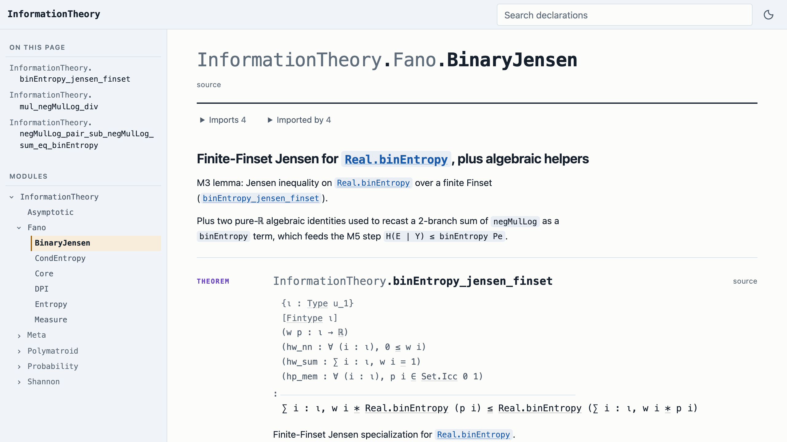

# litedoc4

**HTML documentation for Lean 4 packages built on Mathlib: fast, and every version in one site.**

litedoc4 documents your package and nothing else. Mathlib, Batteries, Lean core, whatever your
`lake-manifest.json` pins, are never regenerated: each reference to them links to that
dependency's source on GitHub, at the exact revision you build against. The output is a static
site.

<picture>
  <source media="(prefers-color-scheme: dark)" srcset="docs/images/site-dark.png">
  
</picture>

- [information-theory](https://fujiharuka.github.io/information-theory/): a package of about 420
  modules on Mathlib
- [mathlib.fuji.land](https://mathlib.fuji.land): Mathlib itself, twelve releases in one site
- [sample](https://fujiharuka.github.io/litedoc4/sample/): a small package showing every shape a
  page can take

## Why it is fast

- **Your package, not Mathlib.** doc-gen4 writes pages for everything you import; litedoc4 writes
  yours and links to the rest.
- **Only what changed.** A rebuild extracts again only the modules whose oleans moved.
- **One Lean environment.** Modules are extracted in parallel threads inside one environment,
  instead of one process per module that loads its imports again.

| | doc-gen4 | litedoc4 |
|---|---:|---:|
| A package of 419 modules on Mathlib | documents all of Mathlib too | **14 s** |
| Batteries | 80 s | **8.5 s** |
| Mathlib | 1 h 53 min | **9.4 min** |

All (measured) on GitHub `ubuntu-latest` runners on 2026-10-17, Lean v4.31.0 for the first row
and v4.35.0 for the others; doc-gen4's times include the pages it also writes for Lean core and
dependencies. Conditions are on the
[Performance](https://fujiharuka.github.io/litedoc4/performance/) page; logs:
[`benchmarks/results/information-theory-ci-2026-10-17.txt`](benchmarks/results/information-theory-ci-2026-10-17.txt),
[`benchmarks/results/batteries-docgen4-litedoc4-2026-10-17.txt`](benchmarks/results/batteries-docgen4-litedoc4-2026-10-17.txt),
[`benchmarks/results/docgen4-runner-2026-10-17.txt`](benchmarks/results/docgen4-runner-2026-10-17.txt).

## Every version in one site

Name tags, branches or commits, and litedoc4 builds one site of all of them. Each version lives
under its own path, and a version switcher on every page keeps you on the same page. Built versions
are kept, so adding a release costs only that release: adding Mathlib's twelfth release to
mathlib.fuji.land took about 12 minutes (measured,
[`benchmarks/results/mathlib-site-add-one-2026-10-17.txt`](benchmarks/results/mathlib-site-add-one-2026-10-17.txt)).

## Quickstart

You need `elan` and a package that `lake build` passes. Add one line to your `lakefile.lean` (or
its `[[require]]` equivalent in `lakefile.toml`):

```lean
require «litedoc4» from git "https://github.com/FujiHaruka/litedoc4" @ "v2.0.0"
```

Then build the site and serve it. The pages are drawn by a script, so open them over HTTP, not
from disk:

```sh
lake run docs -- --out ../mypkg-docs
python3 -m http.server -d ../mypkg-docs/site
```

Nothing is downloaded: the first run builds litedoc4 from the revision you pinned, which takes
about a minute, once (measured on `ubuntu-latest`,
[`benchmarks/results/information-theory-ci-2026-10-17.txt`](benchmarks/results/information-theory-ci-2026-10-17.txt)).
Keep `--out` between runs so the next one rebuilds only what changed.

## Publish on GitHub Pages

Save this as `.github/workflows/docs.yml` and set Settings → Pages → Source to GitHub Actions.

```yaml
name: docs
on: { push: { branches: [main] } }
jobs:
  docs:
    runs-on: ubuntu-latest
    permissions: { contents: read, pages: write, id-token: write }
    environment: { name: github-pages }
    steps:
      - uses: actions/checkout@v7
      - uses: FujiHaruka/litedoc4@v2.0.0
        id: docs
        with:
          cache-get: true             # `lake exe cache get` — drop it if you have no Mathlib
      - uses: actions/upload-pages-artifact@v5
        with: { path: "${{ steps.docs.outputs.site }}" }
      - uses: actions/deploy-pages@v5
```

The action builds your package and the docs in one job and caches what the next run needs. For
several versions, add `versions: v0.4.0,v0.5.0,main` under `with:` and give `actions/checkout`
`fetch-depth: 0`.

## Coming from doc-gen4

litedoc4 keeps doc-gen4's page paths, declaration anchors, docstring Markdown and bibliography
format, so links and docstrings written for a doc-gen4 site work unchanged. What differs:

| | doc-gen4 | litedoc4 |
|---|---|---|
| Dependencies | Pages for your whole import closure | Your package only; dependency names link to their source |
| Search | Every declaration you import | Your package's declarations |
| Math | MathJax, in the browser | MathML, at build time |
| Pages | Static HTML | Drawn by a script; serve them over HTTP |
| Not in litedoc4 | | The tactics page, `find/?pattern=` links, declaration data as JSON, local-file and VS Code source links |

## Requirements

- **Source on GitHub.** For another host, pass `--source-url`.
- **Lean v4.31.0, v4.32.2, v4.33.0, v4.33.1, v4.34.1 or v4.35.0.** Any other version is refused by
  name before anything runs.
- **Linux and macOS.** Windows has not been tried.

## Documentation

Everything else — commands and flags, several versions, watching while you work, configuring the
site, the action's inputs, compatibility — is at <https://fujiharuka.github.io/litedoc4/>
([日本語](https://fujiharuka.github.io/litedoc4/ja/)).

## License

Apache-2.0 ([`LICENSE`](LICENSE)). litedoc4 is a derivative work of doc-gen4 (Apache-2.0, © 2021
Henrik Böving); attribution is in [`NOTICE`](NOTICE).
